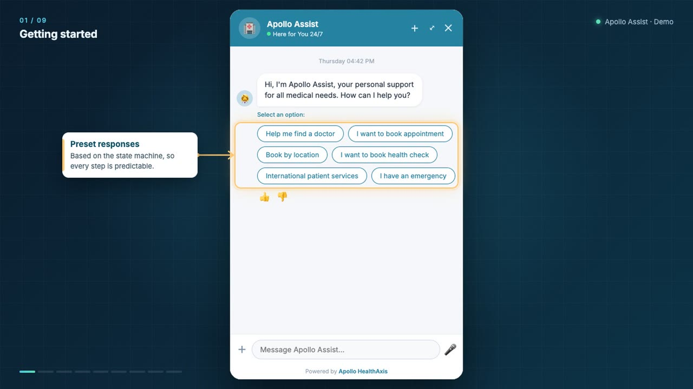

# Apollo Assist — AI Healthcare Assistant

Apollo Assist is a conversational assistant for Apollo Hospitals. Patients can find the right doctor, describe their symptoms, and book, reschedule or cancel real hospital appointments just by chatting, in English or their own language.

It is built as an embeddable chat widget (React + XState) backed by an Express API that orchestrates Google Gemini, a fuzzy doctor search over 6,400+ Apollo doctors, and Apollo's EDOC hospital booking system.

## Demo

[](docs/media/apollo-assist-demo.mp4)

▶️ **[Watch the demo video (3.5 min)](docs/media/apollo-assist-demo.mp4)**: plain-language search, live slots, booking, reschedule and cancel, symptom triage, Hindi support and emergency detection.

> The video was recorded against the real frontend and doctor search. Gemini, EDOC and OTP responses were simulated because no live credentials were used.

## Features

- **Preset quick actions:** buttons for common journeys (find a doctor, book, book by location, health checks, international patients, emergency), driven by a deterministic state machine.
- **Plain-language requests:** "I need a cardiologist in Hyderabad" is understood by an AI agent that extracts specialty, city, branch and doctor name, and skips steps that are already answered.
- **Doctor discovery:** fuzzy search (Fuse.js) over 6,400+ doctors by name, specialty, city and branch, tolerant of typos and spelling variants.
- **Live availability:** dates and time slots come straight from Apollo's EDOC system on each doctor card.
- **End-to-end booking:** mobile number entry, patient record (UHID) lookup or creation, duplicate-appointment check, confirmation summary and booking.
- **Reschedule and cancel** from inside the chat.
- **AI symptom triage:** asks follow-up questions, rates urgency, warns on high-urgency symptoms and recommends a specialty.
- **Multilingual:** detects Hindi, Telugu, Tamil, Kannada, Malayalam, Bengali and more, and translates replies and buttons.
- **Emergency detection** from any point in the conversation, with Apollo 1066 and national 112 numbers.
- **Feedback:** thumbs up or down on answers, with reasons.

## How it works

> **The LLM proposes. The state machine executes.**

```
┌──────────────────────────┐      ┌─────────────────────────────┐      ┌──────────────────────────┐
│  Chat widget (React 19)  │      │      Express 5 API          │      │   Services & data        │
│  ───────────────────────  │ ───▶ │  Helmet · CORS · rate limits│ ───▶ │  Google Gemini (Groq     │
│  XState v5 workflow       │      │  session validation         │      │  fallback)               │
│  (67 states): search,     │      │  /api/agent/decide, /chat,  │      │  Apollo EDOC (calendars, │
│  triage, booking,         │      │  /triage, /translate-ui     │      │  UHID, booking)          │
│  reschedule, cancel       │      │  /api/doctors (Fuse.js)     │      │  Postgres (Prisma)       │
│                           │      │  /api/edoc/*                │      │  Redis + BullMQ          │
└──────────────────────────┘      └─────────────────────────────┘      └──────────────────────────┘
```

- Free text goes to `/api/agent/decide`, which returns a structured decision (action, target workflow, confidence, entities). Low-confidence decisions fall back to deterministic parsing.
- All transactional steps (UHID lookup, booking, reschedule, cancel) live in the XState machine and dedicated API routes. The LLM never calls the booking system directly.

### Production safeguards

- **Tiered rate limiting:** chat 50/min, intent 80/min, calendar 180/min, bookings 5/min. The widget shows a countdown banner on HTTP 429.
- **Idempotent bookings:** every booking carries a `bookingRequestId`, so a retry or double tap never books twice.
- **Resilient EDOC calls:** exponential backoff with jitter and a circuit breaker.
- **PII masking:** phone numbers, UHIDs, appointment IDs, tokens and API keys are masked in logs.
- **Async audit trail:** BullMQ queues for audit and analytics events, with retries.
- **Admin session replay:** `GET /api/admin/session/:id`, protected by `X-Admin-Key`.
- **Health probes:** `/health` (liveness) and `/ready` (Postgres and Redis checks).

## Tech stack

| Layer | Technology |
|---|---|
| Frontend | React 19, TypeScript, Vite |
| Conversation flow | XState v5 |
| AI | Google Gemini (`@google/generative-ai`), Groq fallback |
| Search | Fuse.js |
| Backend | Express 5, TypeScript (ts-node) |
| Hospital integration | Apollo EDOC API |
| Data | PostgreSQL via Prisma (chat/audit DB and operational DB) |
| Queues and cache | Redis, BullMQ |
| Logging and metrics | pino, prom-client |
| Tests | Vitest |

## Getting started

### Prerequisites

- Node.js 20.19+ (or 22.12+)
- PostgreSQL and Redis (optional for local UI work; the chatbot starts without Redis)
- API credentials: Gemini (or Groq) and Apollo EDOC

### Setup

```bash
npm install
# create a .env file in the project root (see the variables below)
npm run dev            # starts the frontend (http://localhost:5173) and API (http://localhost:3001)
```

### Environment variables

| Variable | Purpose |
|---|---|
| `GEMINI_API_KEY` | Google Gemini API key (primary LLM) |
| `GROQ_API_KEY` | Groq API key (fallback LLM, optional) |
| `GEMINI_MODEL`, `GEMINI_TOOL_MODEL` | Override model names (optional) |
| `APOLLO_EDOC_BASE_URL` | EDOC API base URL |
| `APOLLO_EDOC_AUTH_KEY` | EDOC `AuthKey` header value |
| `APOLLO_EDOC_DEFAULT_LOCATION`, `APOLLO_EDOC_DEFAULT_REGION` | EDOC defaults |
| `DATABASE_URL` | Postgres for chat sessions, messages and audit events |
| `OPERATIONAL_DATABASE_URL` | Postgres for patients, appointments and booking requests |
| `REDIS_URL` | Redis for BullMQ queues |
| `FRONTEND_ORIGIN` | Allowed CORS origin |
| `ADMIN_DEBUG_KEY` | Key for the admin session-replay endpoint |
| `PORT` | API port (default `3001`) |
| `LOG_LEVEL` | pino log level (default `info`) |

### Scripts

| Command | Description |
|---|---|
| `npm run dev` | Run frontend and API together |
| `npm run dev:frontend` | Vite dev server only |
| `npm run dev:server` | Express API only |
| `npm run build` | Production build of the frontend into `dist/` |
| `npm test` | Run the Vitest suite |

## Project structure

```
frontend/
  apolloAssistMachine.ts     XState workflow (all conversation states)
  src/components/ChatWidget  Chat UI: messages, doctor cards, slot picker
  src/hooks/useChatMachine   Bridges XState with the API and AI decisions
  src/stateResponses.ts      Bot messages and quick replies per state
  src/knowledgeBase.ts       Doctor directory, cities, symptom → specialty map
backend/
  index.ts                   Express app, /api/chat, /api/agent/*
  routes/                    doctors, EDOC, intent/triage, sessions, uploads, admin, health
  infra/                     EDOC client, retry with backoff + circuit breaker
  providers/ services/       Patient/appointment providers (EDOC + Prisma)
  queues/ workers/           BullMQ audit and analytics
  prisma/ prisma-operational/ Database schemas and migrations
  tests/                     Vitest tests
data/                        Doctor dataset and branch → location map
docs/media/                  Demo video and poster
```

## Further reading

- [PROJECT_STATUS.md](PROJECT_STATUS.md): detailed architecture snapshot, known issues and remaining work
- [TESTING.md](TESTING.md): QA guide with test scenarios for every workflow
